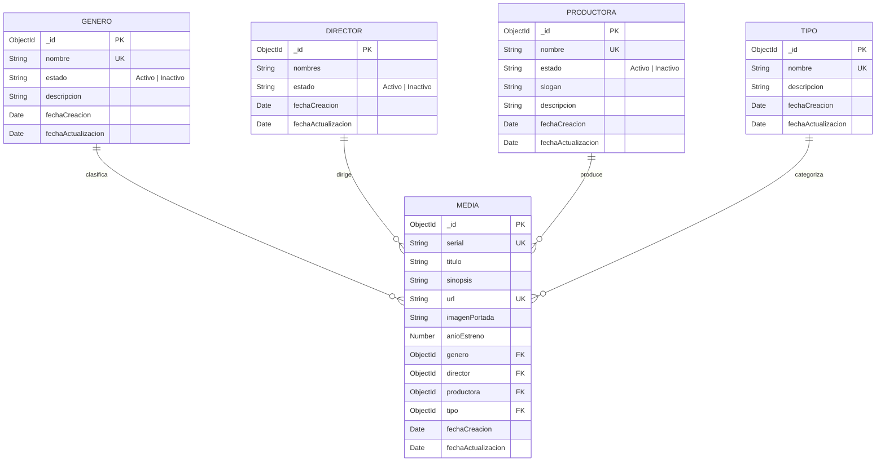

# API REST Películas y Series — IU Digital de Antioquia

API REST construida con **Node.js, Express y MongoDB (Mongoose)** para el caso de estudio *"Aplicación web de películas en modo Administrador"* (tipo Cuevana, sin piratería) del curso **Proyecto Integrado II – Desarrollo de Aplicaciones Web**.

La API implementa los cinco módulos del caso de estudio con operaciones de **crear (POST), listar y consultar (GET), actualizar (PUT) y eliminar (DELETE)**:

| Módulo | Recurso | Campos |
|---|---|---|
| Género | `/api/generos` | nombre, estado (Activo/Inactivo), descripción, fecha creación, fecha actualización |
| Director | `/api/directores` | nombres, estado (Activo/Inactivo), fecha creación, fecha actualización |
| Productora | `/api/productoras` | nombre, estado (Activo/Inactivo), slogan, descripción, fecha creación, fecha actualización |
| Tipo | `/api/tipos` | nombre, descripción, fecha creación, fecha actualización |
| Media (películas y series) | `/api/medias` | serial (único), título, sinopsis, URL (única), imagen de portada, año de estreno, género, director, productora, tipo, fecha creación, fecha actualización |

## Diseño de la base de datos

Base de datos documental MongoDB con cinco colecciones. `medias` referencia a las otras cuatro colecciones mediante `ObjectId` (relaciones *muchos a uno*: una media tiene **un único** género, director principal, productora y tipo, como lo exige el caso).



Las fechas de creación y actualización las gestiona Mongoose automáticamente (`timestamps`).

## Reglas de negocio implementadas

- Al crear o editar una media solo se pueden asignar **géneros, directores y productoras en estado `Activo`** y **tipos existentes** (responde `400` indicando el campo).
- `serial` y `url` de la media son **únicos**; los nombres de género, productora y tipo también (responde `409`).
- No se puede eliminar un género, director, productora o tipo que esté asignado a una media (responde `409`); se sugiere inactivarlo.
- Validación de entrada con `express-validator` (campos obligatorios, estados permitidos, URLs válidas, año de estreno, ids válidos).
- `PUT` permite actualizaciones parciales: solo se modifican los campos enviados.
- El script `npm run seed` carga los datos iniciales del caso: géneros *Acción, Aventura, Ciencia ficción, Drama, Terror* y tipos *Película, Serie*.

## Estructura del proyecto

```
src/
├── index.js               # Punto de entrada: conecta a MongoDB y levanta el servidor
├── app.js                 # Configuración de Express, middlewares y rutas
├── dev-memory.js          # Arranque con MongoDB en memoria (demostración sin instalar MongoDB)
├── seed.js                # Datos iniciales (géneros y tipos)
├── db/db-connection.js    # Conexión a MongoDB con Mongoose
├── models/                # Esquemas: Genero, Director, Productora, Tipo, Media
├── controllers/           # Lógica de cada módulo
├── routes/                # Endpoints y validaciones de cada módulo
└── middlewares/           # Validación de campos y manejo centralizado de errores
postman/API-Peliculas.postman_collection.json   # Colección para probar la API
tests/api.test.js          # Pruebas automáticas de extremo a extremo
```

## Instalación y ejecución

Requisitos: Node.js 20.19 o superior y una base de datos MongoDB (local o [MongoDB Atlas](https://www.mongodb.com/atlas)).

```bash
git clone https://github.com/simoniudigital/api-peliculas-iudigital.git api-peliculas
cd api-peliculas
npm install
cp .env.example .env      # editar MONGO_URI con la cadena de conexión
npm run seed              # opcional: carga géneros y tipos iniciales
npm start                 # o npm run dev (con nodemon)
```

El servidor queda disponible en `http://localhost:4000`.

**Sin MongoDB instalado:** `npm run dev:memory` levanta la API con una base de datos en memoria y los datos iniciales ya cargados (los datos se pierden al detener el servidor).

**Pruebas automáticas:** `npm test` ejecuta las pruebas de extremo a extremo de los cinco módulos.

## Endpoints

Todos los módulos siguen la misma convención REST:

| Método | Ruta | Descripción | Respuesta |
|---|---|---|---|
| GET | `/api/{recurso}` | Lista todos los registros | 200 |
| GET | `/api/{recurso}/:id` | Consulta un registro por id | 200 / 404 |
| POST | `/api/{recurso}` | Crea un registro | 201 / 400 / 409 |
| PUT | `/api/{recurso}/:id` | Actualiza un registro | 200 / 400 / 404 / 409 |
| DELETE | `/api/{recurso}/:id` | Elimina un registro | 200 / 404 / 409 |

Filtros disponibles:

- `GET /api/generos?estado=Activo`, `GET /api/directores?estado=Activo`, `GET /api/productoras?estado=Activo`
- `GET /api/medias?titulo=texto&genero=<id>&director=<id>&productora=<id>&tipo=<id>`

Las respuestas de media incluyen los datos del género, director, productora y tipo (`populate`).

### Ejemplos de cuerpo (JSON)

**POST /api/generos**
```json
{ "nombre": "Comedia", "estado": "Activo", "descripcion": "Historias que buscan hacer reír" }
```

**POST /api/directores**
```json
{ "nombres": "Christopher Nolan", "estado": "Activo" }
```

**POST /api/productoras**
```json
{ "nombre": "Warner Bros", "estado": "Activo", "slogan": "The stuff that dreams are made of", "descripcion": "Estudio de cine estadounidense" }
```

**POST /api/tipos**
```json
{ "nombre": "Documental", "descripcion": "Producción basada en hechos reales" }
```

**POST /api/medias**
```json
{
  "serial": "PEL-001",
  "titulo": "Interstellar",
  "sinopsis": "Un grupo de exploradores viaja a través de un agujero de gusano.",
  "url": "https://peliculas.iudigital.edu.co/interstellar",
  "imagenPortada": "https://placehold.co/300x450/png",
  "anioEstreno": 2014,
  "genero": "<id de un género activo>",
  "director": "<id de un director activo>",
  "productora": "<id de una productora activa>",
  "tipo": "<id de un tipo>"
}
```

**Respuesta de error de validación (400)**
```json
{ "ok": false, "msg": "Error de validación", "errores": [{ "campo": "director", "msg": "El director está inactivo" }] }
```

## Prueba con Postman

1. Importar `postman/API-Peliculas.postman_collection.json` en Postman.
2. Verificar la variable de colección `baseUrl` (por defecto `http://localhost:4000`).
3. Ejecutar las carpetas en orden (1. Género → 5. Media → 6. Validaciones). Las peticiones de creación guardan automáticamente los ids en variables (`generoId`, `directorId`, `productoraId`, `tipoId`, `mediaId`) que usan las siguientes peticiones.

## Tecnologías

Node.js · Express 5 · MongoDB · Mongoose · express-validator · dotenv · cors · morgan · nodemon · mongodb-memory-server

## Integrantes

- Simón Castaño Ríos
- Juan Pablo Gonzalez Gil
- Luisa Fernanda Gómez Quiroz
